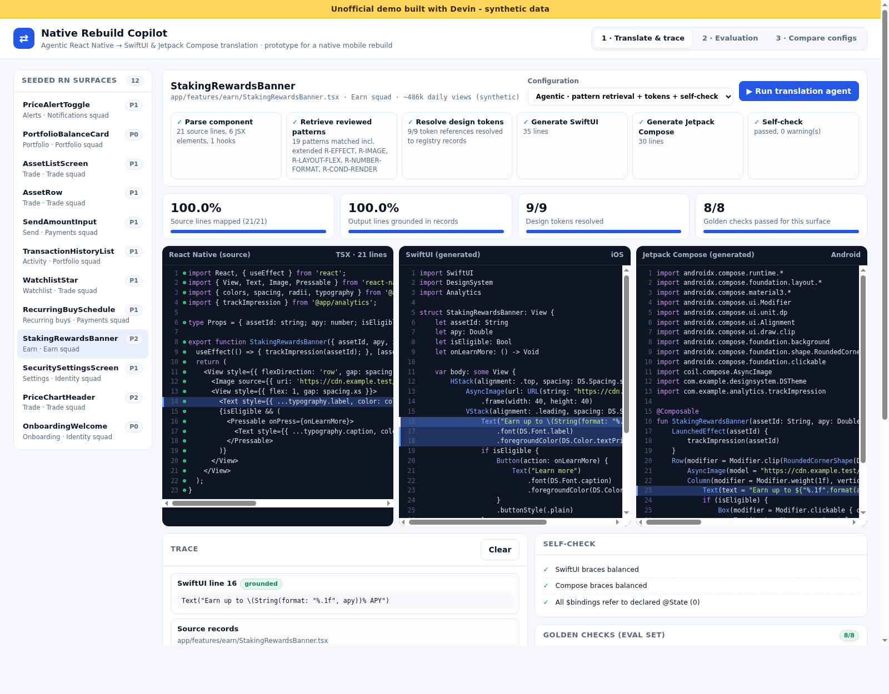

# Native Rebuild Copilot (unofficial demo)

> **Unofficial demo built with Devin - synthetic data.** Not affiliated with or endorsed by Coinbase. Every record is fictional and generated by `scripts/seed.py`.

**Live demo:** https://htmlpreview.github.io/?https://github.com/AlexBiller/coinbase-agentic-migration-demo/blob/main/index.html (renders the static files in this repo; no build step). The `gh-pages` branch is ready too: once GitHub Pages is enabled in repo settings (Settings → Pages → deploy from `gh-pages`), the demo will also be at https://alexbiller.github.io/coinbase-agentic-migration-demo/

A small prototype of an **agentic code-translation workflow** for rebuilding a React Native app as native SwiftUI (iOS) and Jetpack Compose (Android). It's inspired by a public job posting for a native mobile rebuild that uses AI-driven agentic workflows to translate every core surface.



## What you can do (under 5 minutes)

1. **Translate & trace**: pick one of 12 seeded RN surfaces and click **Run translation agent**. The agent parses the file, pulls patterns from a reviewed pattern library, resolves design tokens, generates SwiftUI and Compose, then checks its own output.
2. **Inspect provenance**: click any generated line to see the **source lines**, the **pattern-library rule** (with reviewer and rationale) and the **design-token records** it came from. Click a source line to see every line generated from it. When a construct has no reviewed pattern (ternary render, `useMemo`, `Animated`), the agent sends it to human review and does not guess.
3. **Evaluation**: run 88 golden assertions across all 12 surfaces and see the assertion accuracy, the number of surfaces that fully pass, source coverage and grounding.
4. **Compare configs**: put two configurations side by side (baseline single-pass rules / rules + token retrieval / agentic retrieval + self-check), with per-surface deltas and a line diff of the generated code.

## Run locally

No build step and no dependencies beyond Python 3 (for the seed script and a static server):

```bash
python3 scripts/seed.py          # regenerates data/seed.json + data/seed.js
python3 -m http.server 8000      # then open http://localhost:8000
```

Smoke test (headless Chrome): open `tests/smoke.html`. It runs every configuration and asserts that the agentic config beats the baseline and that every generated line traces back to source.

```bash
google-chrome --headless=new --allow-file-access-from-files --dump-dom file://$PWD/tests/smoke.html | grep SMOKE
```

## How it works

| File | Purpose |
| --- | --- |
| `scripts/seed.py` | Deterministic seed script: RN components, squads, design tokens, pattern library (29 rules), known gaps, 3 agent configs, 88 golden checks |
| `assets/translator.js` | In-browser translator. Translates line by line and attaches `src` lines, `rules`, `tokens` and `guessed` values to every output line. Also contains the self-check and eval scoring |
| `assets/app.js` | UI: translate/trace, evaluation and compare views |

The "AI" here is a deterministic, retrieval-grounded rule engine, so results are reproducible and need no paid model API. In a real system an LLM agent would sit in the same loop (plan → retrieve → generate → verify → escalate), and the same trace and eval harness would score it.

## Data and safety

- All data is synthetic. No real customer data and no real source code.
- No login, no credentials, no external API calls. The page is static and runs entirely client-side.
- No Coinbase systems were accessed.
